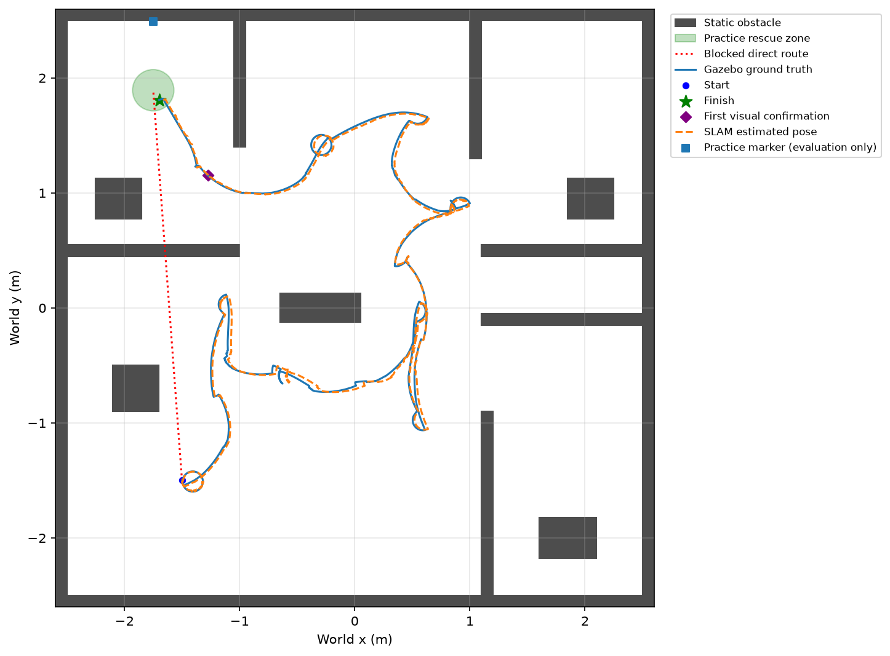

# competition_rooms.sdf 实测记录

2026-10-30 完成仿真，2026-11-10 核对记录与当前配置：用户提供的房间练习场景已通过左上房间进房和室内目标救援的 8 项验收。它不是已核实的官方场地文件。

## 当前配置与通过结果

- 探索通行间距：**0.60 → 0.40 m**；整圈旋转观察仍要求 **0.60 m**。
- Nav2 使用物理轮轴参考点和偏置矩形轮廓；轮廓额外边距 **0.05 m**，大于 5 cm 栅格的半对角线。局部代价地图更新 **10 Hz**，巡航速度 **0.10 m/s**。
- 左上门宽 0.85 m，0.40 m 的探索间距允许规划通行；两个 0.75 m 门口和全场覆盖不属于本次通过范围。

| 场景 | 验收 | 成功探索导航 / 失败尝试 | 目标定位误差 | 真值最小障碍间距 | 救援区最大距离 |
| --- | --- | --- | --- | --- | --- |
| rooms：`autonomy_20261030_120813` | 8/8 通过 | 13 / 0 | 0.0098 m | 0.0675 m | 0.0987 m |
| behind 回归：`autonomy_20261030_161431` | 7/7 通过 | 11 / 0 | 0.0333 m | 0.2204 m | 0.0993 m |

两轮均完成地图和目标清单保存，任务连续停留 3.0 秒，保守车体轮廓的真值采样无障碍重叠。rooms 的独立停留采样覆盖 2.935 秒，behind 为 2.988 秒，符合预先设置的 0.2 秒采样容差；停留期间真实位置不动。rooms 首次确认标记时世界坐标约为 (-1.275, 1.152)，随后进入左上房间完成救援。该坐标仅来自独立验收，未输入任务节点。

完整日志在本机 `artifacts/`，随代码保留 [rooms 验收数据](validation/rooms_evaluation.json)、[behind 验收数据](validation/behind_evaluation.json) 和下图。2026-11-10 核对两轮配置快照均与当前配置逐字节一致，环境锁文件哈希一致，重新运行 20 项单元测试通过。



这验证了单机单目标的练习闭环，不等于所有房间通行、多次随机重复试验或正式比赛验收。路线仍含探索和转向，尚未优化为最短路径。

## 场景内容

源文件：`src/edgeai_robot_description/worlds/competition_rooms.sdf`。

- 约 5 × 5 m 场地，4 面外墙、6 段内部隔墙、5 个箱形障碍物。
- 左上、右上和右下房间入口约为 0.85、0.75、0.75 m。
- 不依赖外部 mesh、纹理或下载模型；世界名为 `empty`，兼容当前机器人 launch。
- 原文件没有 ArUco、救援区或起始区标识。机器人由 launch 生成，原文件不内置机器人属于正常情况。

原文件保持不变，SHA256 为 `a7fe91230c64416c44194ef95d7b4d8bfb3638a754943850c5e1c47420b75d70`。自主测试仅在输出目录的副本中，给左上房间北墙添加 ID 23 练习标记；已核对所有原模型完全保留。任务节点未收到世界坐标或场地真值。

## 原 0.60 m 配置实测结果

1. `gz sdf -k`：Valid。
2. 原文件基础验收：15 项通过，包括生成位置、激光、RGB-D、TF、运动、停车、SLAM、地图保存和重载。前进约 0.214 m，转向约 0.408 rad，停车后无漂移。
3. 自主测试：3 次前沿导航、4 次补充观察均到达，但没有进入左上房间，也没有识别到室内标记。候选观察点耗尽后，任务以 `Timed out: confirmed ArUco target` 结束，退出码为 1。未完成救援。
4. 独立真值检查：保守机器人轮廓无障碍重叠，最小间距 0.2463 m。运行约 276 秒仿真时间。检查通过的导航和无碰撞不能代替完整任务通过。

相关记录：

- `artifacts/baseline_20261030_004543/REPORT.md`：原场景基础验收。
- `artifacts/autonomy_20261030_004733/REPORT.md`：自主任务失败报告及真实轨迹。
- `artifacts/autonomy_20261030_004733/diagnostic_map.yaml`、`.pgm`、`.png`：运行途中导出的诊断地图；不是成功交接的地图或全场地图。
- `artifacts/rooms_review_20261030/layout.png`、`geometry.json`：布局、门宽与离线连通性诊断。

## 原配置失败原因

原配置的探索路径和观察点都要求距非空闲区域至少 0.60 m，相当于要求约 1.20 m 的通行宽度。这不仅排除了三个房间入口，也排除了中央障碍附近通往北侧区域的连接通道。

原 Nav2 配置使用 0.38 m 的保守圆形规划半径，直径 0.76 m；两个 0.75 m 入口对该配置也过窄。0.005 m 分辨率的独立几何分析显示：用 0.29 m 的机器人包围圆时三个房间均连通；用 0.38 m 时只有左上房间连通；用 0.60 m 时三个房间和北侧中央区域均与起点断开。此分析仅用于诊断，没有输入机器人控制，也不等于实际动态通行验收。

后续调整将穿门通行与原地旋转观察分开：探索间距改为 0.40 m，整圈观察要求实际位置达到 0.60 m；Nav2 保持 0.60 m 障碍膨胀，最终使用以物理轮轴为参考的偏置矩形轮廓，巡航速度降为 0.10 m/s。0.40 m 对应约 0.80 m 通行宽度，适用于本次左上房间的 0.85 m 门口；两个 0.75 m 门口仍被保守拒绝，尚未完成全房间通行。场景门宽和碰撞体保持不变。

曾尝试 0.35 m 探索间距、0.35 m 规划圆、0.05 m 到点容差，但机器人在第一处障碍附近转向后无法继续（`artifacts/autonomy_20261030_011126/`，运行被中断）。不能只凭门宽与规划圆的静态几何关系认定可安全通行。当前恢复 0.10 m 到点容差；该模型的驱动轮轴比车体参考点前移 0.0875 m，转向时车体参考点会平移，过严到点容差并不能消除这种运动。

## 探索逻辑修复

0.40 m 初次运行（`artifacts/autonomy_20261030_114309/`）的在线地图已连接下半场和北侧中央区域，但前沿选择器再次过滤了已访问的增量中间点。多条路线共用入口时，这会阻止机器人经原路前往新的探索目标。该轮在诊断后中断，不计作通过。

已保留对探索目的地的访问去重，同时允许经过已访问的中间通路；新增合成栅格测试验证此行为。任务仍只使用在线地图，未加入地图坐标、预设路线或目标位置。OpenCV 线程数限制为 2，减少相机处理与仿真/控制之间的 CPU 竞争。

## 转向参考点修正

`artifacts/autonomy_20261030_115040/` 修复探索过滤后再次暴露转向问题：车体中心与物理轮轴相差 0.0875 m，转向导致车体中心移动并进入旧圆形规划配置的禁止区域，后续导航无法恢复；该轮中断，不计作通过。

自主演示现将原始轮轴里程计换算为车体位姿和速度，Nav2 改用 `drive_axle` 参考点和包含保护区的偏置矩形。目标也按期望航向换算到轮轴参考点；评估和救援停留仍使用原车体位置。原模型、地图、标记位置、验收阈值均未修改，普通手动仿真/基线保留原始里程计接口。

`autonomy_20261030_115724` 使用 0.01 m 轮廓边距时，北侧转向触发近距离保护而中断。最终将边距增加至 0.05 m，并将局部地图更新提高到 10 Hz；随后得到文首的通过结果。保护器和验收阈值均未放宽。

## 复现

```bash
cd /path/to/edgeai_robot_ws

# 在原 SDF 中进行短程运动和传感器/SLAM 验收
./scripts/run_single_robot_baseline.sh \
  --world src/edgeai_robot_description/worlds/competition_rooms.sdf --gui

# 在临时副本里添加室内练习标记，测试完整自主流程
./scripts/run_autonomy_demo.sh --scenario rooms --gui
```

已有的 north、east、behind 场景仍可使用。
