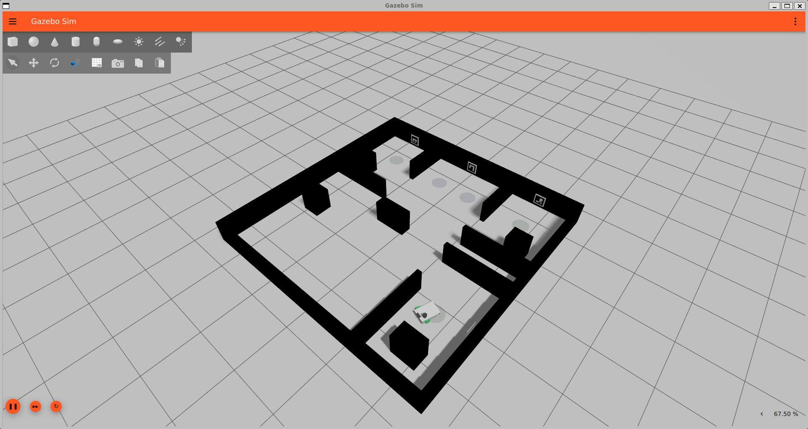
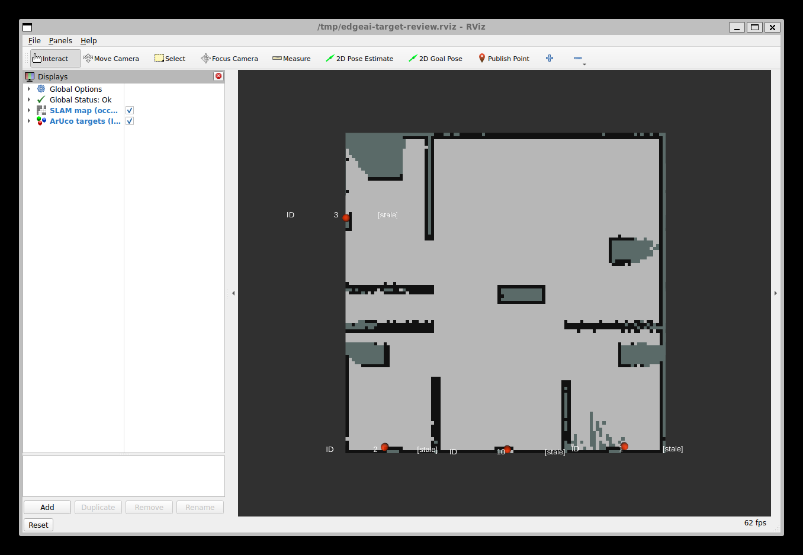

# 建图与目标寻找开发基线（2026-10-30）

本版本接入 ArUco 被动探测、地图中心定位、开阔位置360度观察和低收益前沿冷却。
最近完整测试跑通了探索与目标观测链路，但不是“所有目标已可靠确认”的最终比赛版本。

## 启动方式

```powershell
powershell -ExecutionPolicy Bypass -File .\Start-Autonomous-Exploration.ps1 -Controller dwb -Arena competition -Duration 300
```

```bash
bash scripts/simulation/start-autonomous-exploration.sh --controller dwb --arena competition --duration 300
```

原生 apt ROS Jazzy 为默认后端。目标检测和途中开阔位置观察默认开启。
Windows另加 `-Scan360`（Linux `--scan360`）只表示额外执行一次启动前扫描；
不加这个选项，途中观察仍会工作。Duration为探索阶段现实秒数，启动扫描有独立时间预算。

## 本次实现

- 独立 `edgeai_perception` 包，复用OpenCV ArUco和方形PnP，兼容当前OpenCV4.6。
- 相机30Hz，检测5Hz、地图结果1Hz，均按仿真时间；只处理最新图像，队列有界。
- 使用图像时刻相机TF得到odom观测，再用当前map→odom变换发布地图位置。
- 参数检查包含图像年龄、内参、光学frame、像素尺寸、距离、正深度与重投影误差。
- 首次有效定位记为FOUND，20秒滑动窗口累计三帧后CONFIRMED；10秒无新观测标为stale。
- 输出每轮 `perception.log`、`target-observations.jsonl`、`targets.json`，及ROS观测、估计、标记话题。
- 默认不读目标真值，不发送救援任务或直接发布速度。
- 途中观察只在导航自然结束后申请，中央仲裁忙时拒绝，等待探索暂停确认后重新检查几何。
- 净空半径取 `max(0.50m, 实际车身旋转半径+0.08m)`；本轮实际半径0.3669m。
  排除圈内未知/致命障碍和越界，仍保留Nav2 Spin碰撞检查。
- 需停稳0.4秒、距离全部历史扫描点至少1.2m、两次间隔30秒仿真时间，每轮最多8次。
- 成功、失败或取消后的低收益前沿使用跨冷却历史：30/60/120/240秒递增冷却，新增信息后重置。
- 探索器速度时间模型已同步DWB：0.6m/s、0.9rad/s。
- 修复RViz目标MarkerArray图层Topic配置键；用记录结果回放核实四个ID标记可见。

## 最近完整测试

测试目录：`20261029-235303-826-domain86`，比赛开发场地，未插入额外测试标记。

| 项目 | 结果 |
|---|---:|
| 结束原因 | 上游探索器发布完成事件 |
| 探索阶段现实用时 | 约123秒 |
| 包装脚本退出码 | 0 |
| 已观测地图覆盖率 | 96.62% |
| 地图估计为自由区域比例 | 90.70% |
| 下方右侧房间已观测覆盖率 | 86.89% |
| 目标派发 / 重复派发 | 7 / 0 |
| 导航恢复尝试（汇总器计数） | 0 |
| 途中观察 | 1次，Spin成功，累计6.2921rad，约360.5° |

单轮结果不能用于证明相对于其他配置有统计显著改善。
完成事件只表示探索器没有更多可用前沿，不代表所有区域全部访问或所有目标均确认。

| ArUco ID | 有效定位观测数 | 本轮是否达到三帧确认 |
|---|---:|---|
| 1 | 3 | 是 |
| 2 | 1 | 否 |
| 3 | 1 | 否 |
| 10 | 2 | 否 |

最后输出中四个目标都为stale，表示距最近观测超过10秒，不表示目标记录被删除。
目标位置离散度只是多次观测的一致性，不能替代相对真值定位误差评估。
本轮仍有5条瞬时DWB无合法轨迹警告、2条切换路径取结果错误、81条控制频率告警，
以及RViz地图着色器告警；因此不能称为完全无错误运行。

## 截图与证据边界

以下两张精选图片由用户授权随说明保存；运行日志、完整截图集及每帧结果仍留在本机，未入库。



上图是本轮结束时的原始Gazebo窗口截图，展示开发场地及墙面标记。



上图是**结果回放**，不是运行中的检测画面：加载本轮保存的地图和四个目标坐标，
复用目标发布代码，在独立ROS域95验证修复后的RViz图层。标签stale反映最终记录状态。
回放不证明原测试时目标图层已正确显示，也不提供独立的检测率或定位精度验证。

## 常调位置

| 内容 | 文件 |
|---|---|
| 检测与三帧确认阈值 | `src/edgeai_perception/config/aruco_targets.yaml` |
| 开阔区域与途中扫描 | `src/edgeai_perception/config/observation_scan.yaml` |
| 判定逻辑与扫描调度 | `src/edgeai_perception/scripts/scan_policy.py`、`observation_scan.py` |
| 360度动作与终态确认 | `src/edgeai_perception/scripts/scan360.py` |
| 观察控制权准入 | `src/edgeai_navigation/scripts/navigation_authority.py` |
| 前沿低收益冷却 | `src/edgeai_exploration/config/frontier_exploration.yaml` 的 `repeat_guard_*` |

Linux可用 `EDGEAI_OBSERVATION_SCAN=false` 关闭途中观察，
`EDGEAI_TARGET_SEARCH=false` 关闭探测与自动观察。启用探测时必须启用RGB-D相机。

## 验证和剩余工作

本次复查：三个相关包构建、启动检查、目录与脚本语法、PowerShell启动脚本语法、
几何检查、日志与存储测试、MPPI配置约束、导航仲裁策略和真实ROS交接测试、
ArUco合成图像到地图测试、净空几何和候选数据门槛测试均通过。
新增RepeatGuardTests两项通过；此前完整上游测试中三个旧抢占预期与当前适配策略仍冲突，
本次未把这些冲突隐藏或宣称完整上游测试全部通过。

仍需处理：
1. 图像里看见不一定能解码/定位；当前FOUND在定位通过后才记录，缺少分阶段过滤计数。
2. 只有ID1达到确认，尚无相机可见性分母，不能宣称目标召回率100%。
3. 未做深度融合、目标朝向融合或救援区推导，也未按房间/真实视线收益规划观察位置。
4. odom观测窗口跟随刚体map修正，但不能完全消除SLAM非刚性回环误差。
5. 外层探索无进展计时仍可能与Nav2恢复竞争；低收益面积估计受SLAM更新影响。
6. 历史测试出现Collision Monitor/Gazebo关闭阶段异常；最新一轮退出0不证明该问题已根治。
7. 当前YAML与配置生成模板并非完全一致；直接重新生成可能覆盖手调值。
